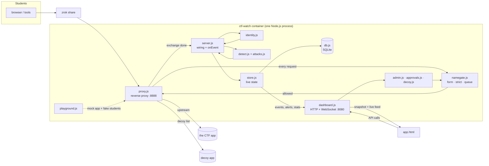
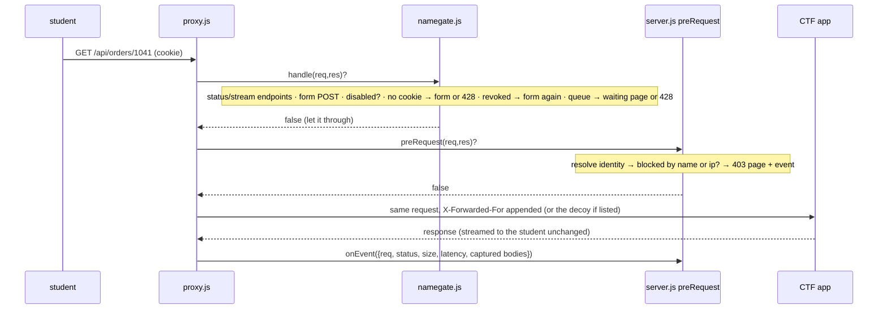
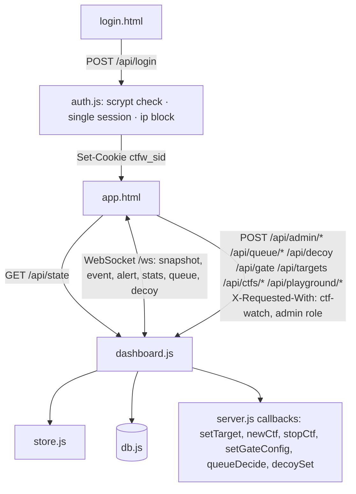

# CTF Watch — developer course (`dev_docs/`)

This folder teaches the code of every component, so that you can read any line of the project and
know what it does, why it is there, and what else depends on it. The audience is a developer who
knows JavaScript and Node.js but has never opened this repository.

If you are an organizer or a SOC analyst who *uses* the dashboard, read [`docs/`](../docs/README.md)
instead.

## How to study

Read the chapters in order; each builds on the previous one. For every chapter:

1. Open the source file next to the chapter and keep both visible.
2. Read the walkthrough with the file: the chapter quotes the code with real line numbers.
3. Do the exercises at the end. Each has the exact command that proves it worked.
4. Run `cd proxy && npm test` before moving on. Green means you broke nothing.

Budget about one hour per chapter; the long ones (`namegate`, `store`, `db`, `dashboard`, `server`,
`app.html`) take two.

## The course

| # | Chapter | File(s) | What you will understand |
|---|---|---|---|
| 0 | [Architecture map](#architecture-map) (this page) | everything | the pieces, the four flows, where state lives |
| 1 | [util](01-util.md) | `proxy/src/util.js` | the helpers every module uses: cookies, JWT decoding, body parsing, client ip, MAC lookup, logging |
| 2 | [mask](02-mask.md) | `proxy/src/mask.js` | how passwords and tokens never reach the logs |
| 3 | [config](03-config.md) | `proxy/src/config.js`, `config/rules.json`, `config/ownership.json` | the detection rules file, how it is compiled and hot-reloaded |
| 4 | [identity](04-identity.md) | `proxy/src/identity.js` | how a request becomes "this student": JWT, session learned at login, the gate name, ip matching |
| 5 | [namegate](05-namegate.md) | `proxy/src/namegate.js` | the gate form, signed cookie, strict mode, the admission queue hand-off, the realtime waiting page |
| 6 | [approvals](06-approvals.md) | `proxy/src/approvals.js` | the queue store |
| 7 | [decoy](07-decoy.md) | `proxy/src/decoy.js` | routing chosen students to a second app |
| 8 | [admin](08-admin.md) | `proxy/src/admin.js` | block, rename, ask to rename, aliases |
| 9 | [detect](09-detect.md) | `proxy/src/detect.js` | IDOR ownership rules, enumeration and burst windows, severity |
| 10 | [attacks](10-attacks.md) | `proxy/src/attacks.js` | the web-attack classifier |
| 11 | [store](11-store.md) | `proxy/src/store.js` | the live in-memory state the dashboard shows, alerts and levels, JSONL |
| 12 | [db](12-db.md) | `proxy/src/db.js` | SQLite: schema, batching, CTF records, players across CTFs, export/import |
| 13 | [query](13-query.md) | `proxy/src/query.js` | the query language: tokenizer, parser, SQL compiler, linting positions |
| 14 | [replay](14-replay.md) | `proxy/src/replay.js` | replaying a recorded CTF into the live view |
| 15 | [proxy](15-proxy.md) | `proxy/src/proxy.js` | the transparent reverse proxy itself |
| 16 | [auth](16-auth.md) | `proxy/src/auth.js` | dashboard accounts, sessions, login conflicts |
| 17 | [ports](17-ports.md) | `proxy/src/ports.js` | discovering candidate CTF apps on the host and in Docker |
| 18 | [playground](18-playground.md) | `proxy/src/playground.js` | the mock app and simulator as child processes |
| 19 | [dashboard](19-dashboard.md) | `proxy/src/dashboard.js` | every API route, the WebSocket feed, security headers |
| 20 | [server](20-server.md) | `proxy/src/server.js` | the entry point: wiring, the event pipeline, lifecycle |
| 21 | [app.html](21-app-html.md) | `proxy/public/app.html` | the single-page dashboard, view by view |
| 22 | [login.html](22-login-html.md) | `proxy/public/login.html` | the login page |
| 23 | [start / stop / inspect](23-start-stop-inspect.md) | `start.sh`, `stop.sh`, `inspect.sh` | the operator scripts line by line |
| 24 | [docker](24-docker.md) | `docker-compose*.yml`, `proxy/Dockerfile`, `.env.example` | how it is packaged and configured |
| 25 | [mock](25-mock.md) | `proxy/mock/*` | the fake CTF, the simulator personas, the load test |
| 26 | [tests](26-tests.md) | `proxy/test/*` | what is covered and how to add a test |
| 27 | [reference cards](27-reference.md) | | environment variables, persisted state, WebSocket messages, commands |

---

## Architecture map

### The pieces

Every box in the container is one file in `proxy/src/`. `server.js` creates them all and hands each
the functions it needs; the modules never require each other's instances, they get callbacks.

### Flow 1 — a student's request

The proxy never buffers the whole exchange: it streams and keeps only the first 64 KB of each body
for inspection (`proxy.js` → `MAX_CAPTURE`).

### Flow 2 — from exchange to event (`server.js` → `onEvent`)

1. Parse the captured request and response bodies (`util.parseBody`).
2. `identity.resolve` once, `identity.learn` (login / whoami may teach a session → name), resolve again.
   Fix-ups: the login request itself is attributed to the learner; gate name wins; `withAlias` applies organizer renames.
3. "has data" heuristic: a 2xx with a body that is not just `{error: …}`.
4. `detector.analyze`: endpoint match → object id → owner (map, self, learned) → flags `idor-attempt`, `idor-success`, `enumeration`, `burst-errors`, severity.
5. `attacks.classify` on the decoded URL, body, UA, referer → `attack:<class>` flags, severity upgrade.
6. Build the event: masked path and body, student fields, player id (`playerIdFor`, cached per row), `decoy` flag.
7. `store.add(ev)`: counters, per-student stats, alert decision, JSONL line, `db.addRequest` (batched), listeners → WebSocket broadcast.

### Flow 3 — the dashboard

Every page of the app is the same `app.html`; the URL path only picks the initial view. Every POST
needs the session cookie and the `X-Requested-With: ctf-watch` header (CSRF). Admin-only routes
check `user.role`.

### Flow 4 — lifecycle of a CTF record

| Action | Where | What happens |
|---|---|---|
| start | `server.js` boot | `db.openCtf(CTF_NAME)`: reuse the open record or create one; accounts regenerated; target restored from `kv proxy_target` |
| pick a target | CTFs tab → `POST /api/targets` | `setTarget`; optionally `newCtf` first so the switch is logged into the new record |
| Stop CTF | `POST /api/ctfs/stop` → `stopCtf` | record closed, target cleared (students see 503), live state reset; next target pick opens a new record |
| New CTF | `POST /api/ctfs/new` → `newCtf` | close current, open next, reset live state, detector, player cache, ip memory |
| replay | `POST /api/replay` → `replay.js` | events of a past record pushed into `store` with `replay: true` (no DB/JSONL writes); `store.replayCtfId` makes alerts, student pages and queries read that record |

### Where state lives

| State | Lives in | Written by | Read by |
|---|---|---|---|
| live events, alerts, per-student stats, rps | memory (`store.js`), bounded ring buffers | `store.add` | WebSocket feed, `/api/state`, `/api/stats` |
| every request, alert | SQLite `requests`, `alerts` | `db.addRequest/addAlert` (batched, 200 ms) | Alerts tab, student detail, Query tab, export |
| CTF records | SQLite `ctfs` | `openCtf/endCtf/importCtf` | CTFs tab, replay |
| players across CTFs | SQLite `players`, `identities` | `playerFor`, `upsertIdentity` | student detail "known player" |
| dashboard accounts, sessions | SQLite `accounts`, `sessions` | `auth.js` | every request to the dashboard |
| proxy target, decoy, gate config, gate profiles, queue, admin state, blocked dashboard ips | SQLite `kv` (JSON values) | the owning module's `save()` | on boot and on change |
| gate cookie secret | `data/.name-gate-secret` | first boot | `namegate.sign` |
| JSONL request log | `logs/events-<date>.jsonl` | `store.writeLog` | humans, external tools |
| zrok link, credentials | `logs/zrok.url`, `logs/zrok.log`, `logs/credentials.txt` | `start.sh`, `server.js` | CTFs tab, `start.sh` |
| detection rules | `config/rules.json`, `config/ownership.json` | the organizer | `config.js` (hot reload) |

### Conventions worth knowing before reading code

- Every module exports a class or a few functions; `server.js` is the only place that knows them all.
- Modules talk through callbacks set by `server.js` (`onProfile`, `onEnqueue`, `onRename`, `onIpNamed`, `onSessionNamed`, `onRenamed`, `isBlocked`, `queueStatus`, `isDecoy`). Grep for `on[A-Z]` in `server.js` to see the wiring.
- A student has a *raw name* (what the gate cookie or the app says) and a *display name* (after an organizer rename). `admin.alias(raw)` maps one to the other; the queue and the gate are keyed by raw, the store by display.
- Nothing in the student-facing path throws: errors become a 502 page or a logged line, never a crash of the proxy.
- `npm test` runs `node --test` over `proxy/test/*.test.js` (45 tests, no framework).
